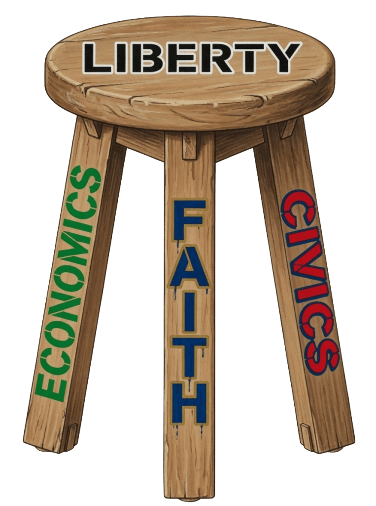

Imagine a stool with three legs. It looks simple, but it’s actually very clever. As long as all three legs are strong and equal, the stool stands steady. Shorten or weaken just one leg, and the whole thing becomes wobbly and eventually falls over.

That’s exactly how Alexis de Tocqueville saw American liberty in 1831. He believed freedom rests on three equal supports:

-   **The Faith Leg** — the moral foundation that teaches people right from wrong, duty over desire, and that some things are worth sacrificing for. Without it, liberty becomes selfishness.
-   **The Economics Leg** — sound money and economic freedom that reward work, saving, and honest trade. When money is manipulated, trust collapses and people grow dependent on government.
-   **The Civics Leg** — the habits of self-government: knowing how a republic works, respecting the rule of law, and actively participating as citizens instead of spectators.

Tocqueville’s warning was blunt: these three legs must stay in balance. America’s genius wasn’t just its Constitution — it was the character and culture that made self-government possible.

Today that balance is off. The faith leg has weakened, the money leg has been debased, and many citizens feel disconnected from the civic leg. The stool is getting shaky.

The mission of the Tocqueville Liberty Institute is simple: strengthen all three legs so liberty can stand again.

Each leg depends on the others. Strong faith supports good economics. Sound money supports stable civics. And healthy civic life protects both faith and economic freedom.

One stool. Three legs. When they work together, liberty stands. When they don’t, it falls.
