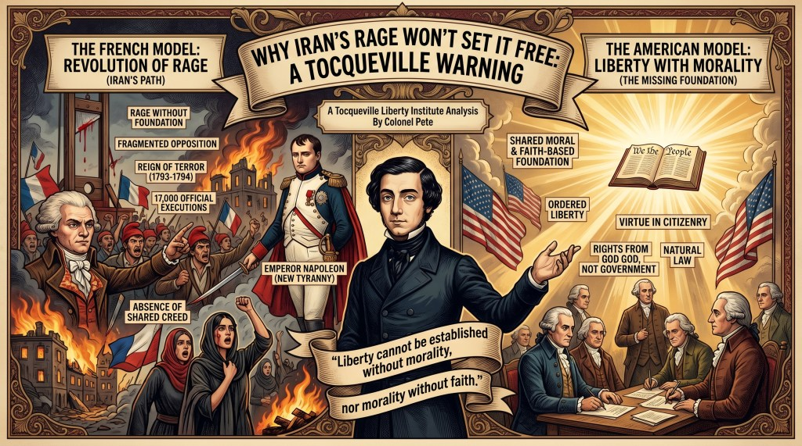

# Why Iran’s Rage Won’t Set It Free: A Tocqueville Warning 

**A Tocqueville Liberty Institute Analysis** *By Colonel Pete* 

The dream of a free, secular, and prosperous Persia rising from the ashes of the Islamic Republic is emotionally powerful. The waves of mass protest that have swept Iran — most dramatically in the *Mahsa Amini* uprising of 2022–2023, and erupting again with extraordinary force in late December 2025 and January 2026 — have revealed the extraordinary depth of public hatred for the regime. Brave Iranians, many of them young women, have risked everything to cry out for freedom. 

Yet despite this widespread and genuine discontent, the hard truth is that a stable, democratic Iran is highly unlikely in the next 10–20 years — short of a profound moral transformation that history suggests only God can author. 

## The Brutality of the Regime 

The uprisings have been met with a level of brutality that should shock the conscience of the civilized world — and has been met largely with silence. 

When mass protests erupted in late December 2025 and surged through January 2026, the Islamic Republic responded not with restraint or negotiation, but with systematic slaughter. Security forces used live fire, targeting vital organs. Mass burials were reported. Bodies disappeared. Families were warned not to mourn publicly. 

The Human Rights Activists News Agency (HRANA), one of the most meticulous and credible trackers of Iranian state violence, documented over **7,000 confirmed deaths** as of early February 2026, with thousands more still under review. \[1\] Amnesty International described January 2026 as **the deadliest period of repression in decades**, with the mass killings of January 8–9 representing a particular low point of state savagery. \[2\] Exile media outlets, including Iran International, reported peak death tolls exceeding **12,000** during the most violent days of the crackdown. \[3\] Aggregated reports — including hospital sources, local witnesses, and exile networks — place the total death toll as high as **30,000 to 36,500.** \[4\] 

To put that in context: the Iranian regime may have killed more of its own citizens in a matter of weeks than the United States lost in the entirety of the Vietnam War. 

The regime has suppressed large-scale protests for now. But it has not extinguished the rage burning beneath the surface. Nor has it extinguished the world’s moral obligation to bear witness. 

That rage is real. It is justified. And it is not enough. 

## The Deeper Problem: A Revolution Without a Foundation 

Raw anger has never been sufficient to build a free society. The deeper problem lies not with the Iranian people’s desire for liberty, but with the opposition itself — its fractures, its contradictions, and its absence of a shared moral foundation. 

The situation in Iran today more closely resembles the French Revolution of 1789 than the American Revolution of 1776. And that comparison should terrify anyone who genuinely wants Iran to be free. 

The American Founders were united by far more than a common enemy. They shared a moral and philosophical foundation — rooted in faith, natural law, and a common vision of ordered liberty. They argued fiercely, but they agreed on the fundamentals: that rights come from God, not government; that power must be constrained by law; that virtue in the citizenry is the essential prerequisite for self-governance. 

Alexis de Tocqueville, observing America in the 1830s, identified this foundation as the secret of American democracy’s durability. “Liberty cannot be established without morality,” he wrote, “nor morality without faith.” \[5\] He understood that a free republic is not merely a political arrangement — it is a moral achievement. It requires citizens who share not just a common enemy, but a common creed. 

This is precisely what the Iranian opposition lacks. 

## The French Revolution Warning 

The Iranian opposition today, like the French revolutionaries of 1789, is united primarily by what it opposes: the Islamic Republic. Beyond that shared hatred, there is little agreement on what should replace it. And history has shown us, with terrible clarity, where that road leads. 

After the French monarchy fell, the revolution rapidly radicalized. Maximilien Robespierre — a radical lawyer and fanatic of revolutionary purity — rose to power and led the infamous Reign of Terror from 1793 to 1794. He famously declared that “terror is nothing but prompt, severe, inflexible justice.” \[6\] Under his rule, approximately 17,000 people were officially executed by guillotine, while another 10,000 to 20,000 died in prison or were murdered without trial. The revolution began devouring its own children — even fellow revolutionaries were sent to the blade. 

Out of this bloody chaos rose Napoleon Bonaparte. In 1799, he seized power in a coup, and by 1804 had crowned himself Emperor of the French — replacing one form of tyranny with another, more seductive form. \[7\] 

Tocqueville drew a direct lesson from this catastrophe. He observed that the French had mistaken the *destruction* of the old order for the *construction* of a new one — and that without the moral and civic foundations necessary for self-governance, liberty had no soil in which to grow. “Despotism,” he warned, “may govern without faith, but liberty cannot.” \[8\] 

Any tyrant can rule through fear. Despotism requires nothing more than sufficient force and sufficient ruthlessness. But a free people must be bound together by something deeper — a shared vision of human dignity, moral responsibility, and ordered liberty. Without that binding force, freedom becomes merely a slogan that competing factions brandish on their way to the next power struggle. History does not offer a single durable exception to this rule. 

## Iran’s Fractured Opposition 

Iran faces precisely this danger. The opposition remains deeply fragmented between: 

-   **Monarchists** loyal to Reza Pahlavi, the son of the deposed Shah, who carries both genuine popular appeal and the heavy baggage of his father’s authoritarian rule 
-   **The MEK** (Mojahedin-e-Khalq), a militant organization that is not only controversial internationally but deeply despised *within* Iran itself — widely viewed by ordinary Iranians as traitors for their alliance with Saddam Hussein during the bloody Iran-Iraq War of the 1980s \[9\] 
-   **Secular republicans** with varying and often mutually incompatible visions of what a post-regime Iran should look like 
-   **Leftists and socialists** whose economic vision clashes sharply with liberal democrats and free-market reformers 
-   **Ethnic and regional factions** — Kurds, Arabs, Baluchis, Azeris — each with their own deep grievances, historical memories, and political ambitions 

Without a unifying moral or philosophical foundation, “freedom” becomes little more than a banner that different factions wave while maneuvering for dominance. The moment the regime falls — if it falls — these factions will turn on each other. History does not merely suggest this. It insists upon it. 

## What a Successful Transition Would Actually Require 

To be fair, diagnosing the problem demands we also honestly examine what a successful democratic transition would actually require. Scholars of democratic transitions identify several critical conditions: \[10\] 

-   **A unifying transitional figure** — someone with broad legitimacy across factions, capable of holding a fragile coalition together long enough to build institutions rather than simply seize power 
-   **Pre-existing civic institutions** — independent courts, civil society organizations, a free press — that can function independently of the regime and provide the scaffolding for democratic governance 
-   **A shared constitutional vision** — agreement not just on removing the old order but on the principles and structures of the new one 
-   **International support** — not military intervention, but sustained diplomatic and economic engagement that rewards democratic institution-building and punishes backsliding 
-   **Time** — democratic consolidation rarely happens in months; it requires years, sometimes decades, of patient institution-building and civic education 

Iran currently lacks most of these conditions. The regime has systematically destroyed independent civic institutions for decades. There is no universally accepted transitional figure. The opposition’s constitutional visions are mutually incompatible. And the international community remains divided, distracted, and inconsistent in its approach to Iran. 

## The Tocqueville Warning for Our Time 

Tocqueville spent much of *Democracy in America* warning that democracy’s greatest enemy is not the tyrant without, but the spiritual and civic vacancy within. A people that has lost its moral foundation — its shared sense of human dignity, responsibility, and transcendent purpose — becomes vulnerable to what he called “soft despotism”: a creeping, paternalistic control that citizens accept in exchange for the illusion of security. \[11\] 

The Iranian regime understands this intuitively. It has worked deliberately for decades to atomize Iranian society — to destroy the bonds of trust, civic association, and shared moral vision that Tocqueville identified as democracy’s essential preconditions. In doing so, it has not merely oppressed the Iranian people. It has made the work of building a free society immeasurably harder. 

This is the cruelest legacy of forty years of theocratic rule. The regime has not just stolen Iran’s wealth and freedom. It has systematically eroded the very civic and moral foundations upon which a free Persia would need to be built. Despotism can survive a population’s rage. What it cannot survive — what no tyranny in history has ultimately survived — is a population united by a shared moral vision, a common creed, and the civic virtue to translate that creed into institutions. 

That is precisely what Iran’s opposition has not yet found. 

## A Dream Deferred — But Not Abandoned 

The desire for a free Persia is real, especially among the younger generation. Their courage is extraordinary. Their suffering is real and profound. The thousands who have already given their lives — verified at over 7,000 and potentially far more — deserve to be remembered not as statistics but as martyrs to the cause of human liberty. 

They deserve our admiration, our solidarity, our advocacy, and our prayers. 

But desire without unity, shared values, and strong institutions is not enough. History is unambiguous: revolutions rooted in rage rather than principle rarely end in liberty. They end in Robespierre. They end in Napoleon. They end in a new tyranny wearing the mask of the old revolution’s ideals. 

Tocqueville’s insight cuts to the heart of Iran’s dilemma. “Liberty cannot be established without morality, nor morality without faith.” \[5\] This is not a call for theocracy — it is the opposite. It is a recognition that genuine liberty requires a shared moral vision that transcends politics, a common creed that binds citizens together not merely in opposition to tyranny but in commitment to one another’s dignity and freedom. 

Absent that profound moral and spiritual awakening among the Iranian people — a renewal of the shared vision and common creed that Tocqueville identified as liberty’s indispensable foundation — a truly free and stable democratic Persia will likely remain a dream deferred for at least another generation. 

That is a sobering conclusion. But it is an honest one. And honesty, as the Tocqueville Liberty Institute has always maintained, is where liberty begins. 

*The Tocqueville Liberty Institute is dedicated to educating Americans — and the world — on the principles of faith, sound money, and civic virtue that make free societies possible. Visit us at TheTocque.org or follow Colonel Pete on X at @Colonel\_Pete.* 

**Liberty through truth. 🇺🇸** 

## References 

\[1\] Human Rights Activists News Agency (HRANA). (February 2026). *Confirmed Death Toll from December 2025 – January 2026 Iranian Protests.* Retrieved from iranhr.net 

\[2\] Amnesty International. (January–February 2026). *Iran: Deadliest Crackdown in Decades as Security Forces Use Live Fire Against Protesters.* Retrieved from amnesty.org 

\[3\] Iran International. (January 2026). *Death Toll Surpasses 12,000 in Peak Days of Iranian Crackdown.* Retrieved from iranintl.com 

\[4\] The Guardian / UN Special Rapporteur on Iran / Human Rights Watch. (2026). *Aggregated Reports on Iranian Protest Suppression: Death Toll Estimates Range from 7,000 to 36,500.* See also: UN Special Rapporteur on the Situation of Human Rights in Iran, Report to the General Assembly, 2026. 

\[5\] Tocqueville, A. de. (1835). *Democracy in America,* Volume I. (Trans. Harvey Mansfield & Delba Winthrop, 2000). University of Chicago Press. 

\[6\] Robespierre, M. (1794). *Speech to the National Convention,* February 5, 1794. Archived in *Oeuvres de Robespierre.* 

\[7\] Englund, S. (2004). *Napoleon: A Political Life.* Scribner. 

\[8\] Tocqueville, A. de. (1835). *Democracy in America,* Volume I. Chapter on religion and liberty. University of Chicago Press. 

\[9\] Abrahamian, E. (1989). *The Iranian Mojahedin.* Yale University Press. 

\[10\] Diamond, L. (1999). *Developing Democracy: Toward Consolidation.* Johns Hopkins University Press. 

\[11\] Tocqueville, A. de. (1840). *Democracy in America,* Volume II, Part IV, Chapter 6. “What Sort of Despotism Democratic Nations Have to Fear.” University of Chicago Press.
